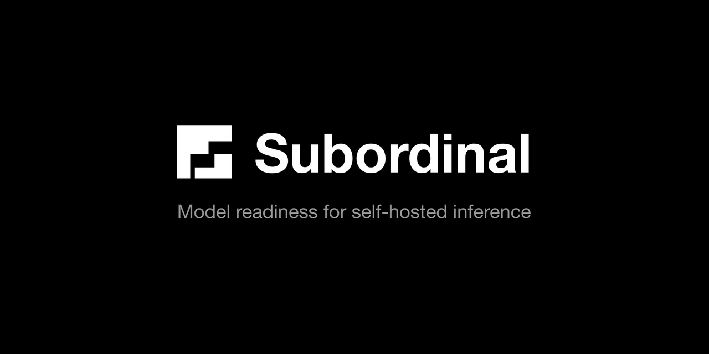

  

## Model readiness for self-hosted inference

Large models take minutes to start, and sometimes they do not start at all. Subordinal tells an ML platform team, before and during a rollout:

- **Will it start?** Model, runtime, quantization and GPU checked against each other.
- **How long until ready?** Startup split into fetch, weight load, compile and init.
- **Why is it slow or failing?** One diagnosis across storage, cache, runtime and Kubernetes.
- **What fixes it?** A concrete change, and the GPU cost of the time spent not serving.

Vendor neutral, across vLLM, SGLang, KServe and Kubernetes. Open source first.

**Status:** early development. Nothing is released yet.
